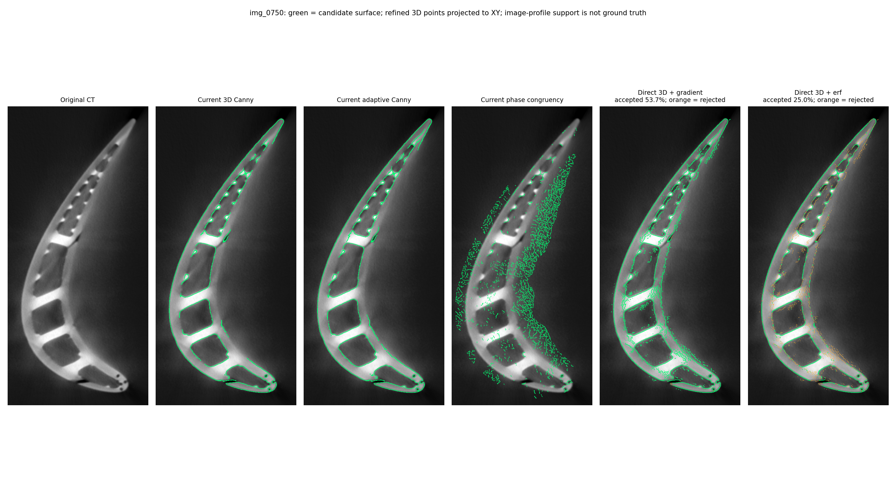

# Сохранённые результаты сравнения

**[Новые сравнения и диагностика правой внешней границы](right_boundary/README.md).**

Это результаты исследовательского запуска на исходных 16-битных TIFF.
**Полная точная поверхность перехода пока не восстановлена.** Зелёный цвет
показывает кандидатов, прошедших соответствующие проверки; оранжевый — отклонённые
профили с достаточным контрастом. Цвет не является эталонной разметкой точности.
3D-точки спроецированы на XY для просмотра; их уточнённый Z может отличаться
от центральной плоскости.

Основное сравнение для переходного среза `img_0750`:

Другие проверенные сечения с теми же параметрами:

- [img_0625: сравнение методов](comparison_0625.png).
- [img_0875: сравнение методов](comparison_0875.png).
- [img_0988: сравнение методов](comparison_0988.png).
- [img_0750: исходные профили и совместная подгонка двух границ](double_profiles_0750.png).

Все четыре сравнения используют по 17 различных соседних срезов.
Три C++-детектора запущены без изменения алгоритмов и параметров; менялись
только пути, позиции в списке TIFF и сохранение вспомогательных изображений.
Числа edge pixels в [проверке C++ baseline](cpp_baseline_validation.json)
не являются показателями точности. Проверка среза 0500 отдельно помечена
непригодной для сравнения Canny: это первая доступная Z-плоскость без предыдущих
соседних данных, и исходный NMS её не обрабатывает.

Численные результаты:

- [Параметры и результаты профилей четырёх реальных сечений](real_profile_metrics.json).
- [Синтетическая проверка одиночного перехода: 7 случаев](synthetic_single_edge_validation.json).
- [Синтетическая проверка двух близких границ: 8 случаев](synthetic_double_edge_validation.json).
- [Две границы на реальных данных: 800 проверенных профилей](real_double_edge_metrics.json).
- [Чувствительность среза 0750 к изменению сглаживания](smoothing_sensitivity_0750.json).

Для среза `0750` сохранены [CSV со всеми кандидатами и флагами](points_0750.csv.gz)
и [PLY принятых erf-кандидатов](erf_points_0750.ply). CSV сжат gzip; после
распаковки его можно открыть в табличном редакторе. PLY — облако точек,
не замкнутая сетка детали. Отклонённые координаты в CSV равны исходному seed;
они не должны интерпретироваться как измеренная поверхность.

Единицы координат — исходные воксели. `source_z=750` соответствует
`img_0750.tif`. В PLY порядок X,Y,Z. Перевод в микроны не выполнялся.
Согласие методов и успешный fit не заменяют калибровку и независимый эталон.

[Подробный разбор статей и ограничений](../RESEARCH.md).
[Инструкция воспроизведения](../README.md).
[Происхождение C++ baseline](cpp_baseline_provenance.json).
`publication_manifest.json` фиксирует хеши опубликованных исходников и результатов.
