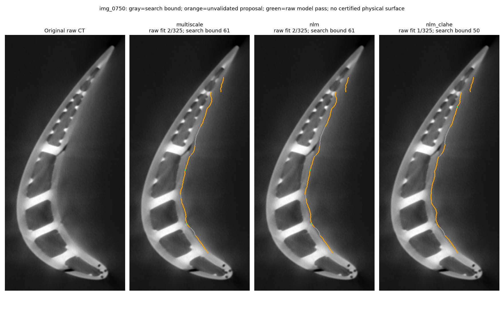

# Правая внешняя граница: диагностика и новые сравнения

**Точная полная поверхность пока не подтверждена.**
[Разбор причин, статьи и параметры](../../RIGHT_BOUNDARY.md).

На новых рисунках серый цвет означает предел поискового коридора, оранжевый —
неподтверждённое предложение, зелёный — прохождение локальной raw-модели.
Даже зелёный цвет не является независимой проверкой физической точности.
Линия может задаваться геометрическим ограничением и регуляризацией.

- [Контроль 0625](right_comparison_0625.png).
- [Срез 0875](right_comparison_0875.png).
- [Срез 0988](right_comparison_0988.png).
- [На каком этапе теряются точки 0750](diagnosis_0750.png).
- [Подробная диагностика старого pipeline](diagnosis.json).
- [Новые параметры и метрики](metrics.json).
- [Проверка адаптивного профиля на известной геометрии](adaptive_validation.json).
- [Проверка всей цепочки и отрицательный тест без границы](proposal_validation.json).

CSV `points_<вариант>_<срез>.csv` сохраняют все325 предложений, координаты raw-fit,
признак принятия, ограничение поиска и флаги окон6/12/24. При отказе координаты
остаются в seed. `corridor_XXXX.csv` содержит приблизительные координаты полного
Otsu, cropped-Otsu и ROI — это локаторы, не эталоны.

Денойзинг в проверенной настройке не дал подтверждённого восстановления полной
границы. Особенно заметные изменения после CLAHE не принимаются за новые размеры
детали. Исходные `comparison_XXXX.png` предыдущего исследования сохранены.
